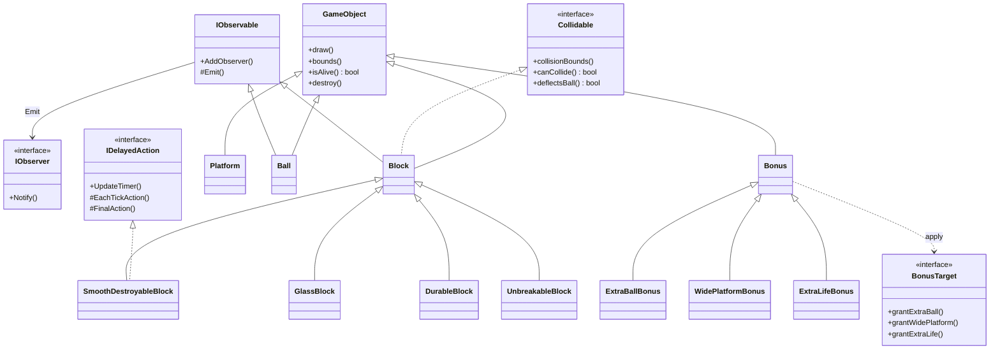
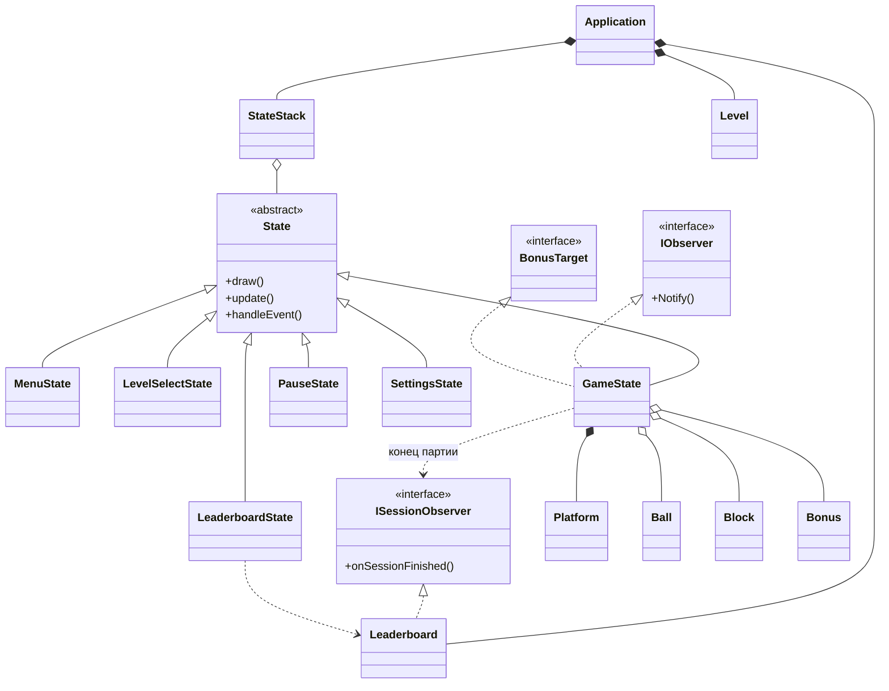
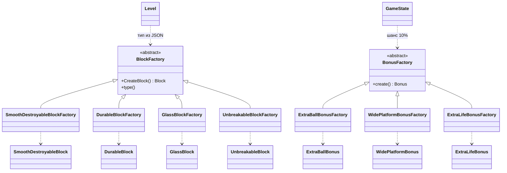

# Arkanoid

Игра на C++ и SFML 3. Ниже схема классов. `State`, `StateStack`, `IObserver` и `IObservable` лежат в глобальном пространстве имён, остальные классы — в `Game`.

## Объекты на поле

`Block` и `Ball` сообщают о себе через `Emit()`. `GameState` подписан как `IObserver`. Бонус при подборе вызывает метод `BonusTarget`, этот интерфейс тоже реализует `GameState`.

Очки за разрушение: стекло 1, исчезающий блок 2, крепкий блок — столько, сколько у него ударов.

## Состояния

`Application` владеет стеком состояний, текущим уровнем и таблицей рекордов. Конец партии `GameState` не рисует сам: он вызывает `onSessionFinished`, а экран рекордов только читает `Leaderboard`.

## Фабрики

Какая фабрика сработает, выбирается по строке типа блока или случайно для бонуса. Сам объект собирает наследник в `CreateBlock()` или `create()`.

